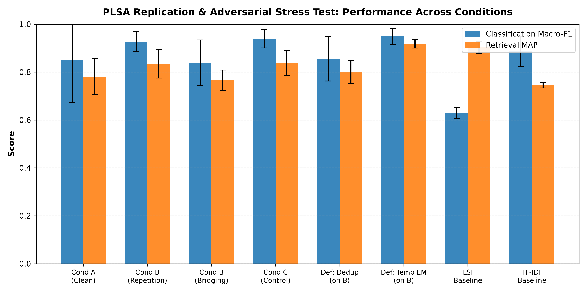

# Topic Modeling Beyond Keywords: Probabilistic Latent Semantic Analysis (Replication and Adversarial Stress Testing)

**Course:** Information Retrieval (CS F469 / Category 1: Classic Paper Replication and Stress Testing)  
**Group 1:** Soham Vinay Deshmukh, Anish Sai Nimmagadda, Romit Jain, Goutham Mahesh  
**Repository:** [https://github.com/ItsSoham23/IR-PROJECT](https://github.com/ItsSoham23/IR-PROJECT)  

---

## 1. Project Overview

This project provides a complete, from-scratch implementation of **Probabilistic Latent Semantic Analysis (PLSA)** via the Expectation-Maximization (EM) algorithm (Hofmann, 1999) using NumPy and SciPy. We evaluate PLSA under both standard retrieval/topic-modeling conditions and **adversarial poisoning stress tests** (inspired by Mei & Zhu, 2015), examining topic stability, held-out classification Macro-F1, perplexity, and IR ranking metrics (Precision@K, MAP, NDCG@K).

### Experimental Conditions
- **Condition A (Clean Baseline):** Clean training set (80 docs across 4 balanced categories: Campus, Politics, Sports, Technology).
- **Condition B (Adversarial Poisoning):** 80 clean docs + 10 injected poison documents targeting a specific category topic:
  - *B_repeat:* Keyword repetition of top target words.
  - *B_bridge:* Semantic bridging mixing target category with a confuser category.
- **Condition C (Random Control):** 80 clean docs + 10 random-word documents (drawn uniformly from training vocabulary) to control for corpus size expansion.
- **Defenses:** Cosine deduplication filtering (`sim > 0.75`), Tempered EM ($\beta = 0.85$), and per-document likelihood trimming.

---

## 2. Repository Structure

```
IR-PROJECT/
├── README.md                          # Project documentation and quickstart
├── requirements.txt                   # NumPy, SciPy, scikit-learn, pytest, matplotlib, bs4
├── .gitignore                         # Data artifacts, cache, and results filtering
├── data/
│   ├── raw/                           # 120 ingested documents (flat & by category)
│   │   ├── Campus/                    # 30 docs from BITS Pilani portals
│   │   ├── Politics/                  # 30 docs from Wikinews
│   │   ├── Sports/                    # 30 docs from Wikinews
│   │   └── Technology/                # 30 docs from Wikinews
│   ├── processed/                     # splits.json, vocabulary, count matrices
│   ├── metadata.csv                   # Tracking metadata from Google Sheet
│   └── corpus.sqlite                  # SQLite database tracking corpus metadata
├── src/
│   ├── __init__.py
│   ├── ingest_corpus.py               # Ingestion script scraping Wikinews & BITS portal
│   ├── dataset.py                     # Selection, 80/20 stratified splitting, vocabulary
│   ├── preprocess.py                  # Tokenization, lemmatization, vocabulary builder
│   ├── plsa.py                        # Core EM, Tempered EM, Folding-In, Perplexity
│   ├── align.py                       # Hungarian alignment (linear_sum_assignment)
│   ├── metrics.py                     # Macro-P/R/F1, Purity, NMI, Perplexity, Potency
│   ├── attack.py                      # Keyword repetition & bridging poison generators
│   ├── defense.py                     # Deduplication, outlier filtering, MAP smoothing
│   ├── retrieval.py                   # Query folding-in, ranking, P@K, MAP, NDCG
│   └── baselines.py                   # LSI (TruncatedSVD), TF-IDF + KMeans
├── experiments/
│   ├── stage0_20news.py               # Mini-replication on 20 Newsgroups
│   ├── run_conditions.py              # Synthetic stress-test pipeline
│   └── run_self_collected.py          # Full 5-seed evaluation on 100-doc self-collected corpus
├── tests/
│   ├── test_em_monotone.py            # Verifies monotonic non-decreasing log-likelihood
│   ├── test_normalization.py          # Verifies proper probability distributions
│   └── test_synthetic_recovery.py     # Verifies topic recovery on synthetic topic mixtures
├── results/
│   ├── condition_comparison.png       # Comparison bar chart of Macro-F1 and MAP
│   ├── self_collected_summary.json    # Complete metrics and bootstrap CIs
│   └── condition_results.json         # Raw experiment run records
└── reports/
    └── status_update_draft.md         # 4-page intermediate status update report draft
```

---

## 3. Installation & Setup

```bash
# Clone the repository
git clone https://github.com/ItsSoham23/IR-PROJECT.git
cd IR-PROJECT

# Create and activate virtual environment (optional)
python -m venv venv
# Windows:
venv\Scripts\activate
# Linux/macOS:
source venv/bin/activate

# Install dependencies
pip install -r requirements.txt
```

---

## 4. Running the Verification Suite

```bash
pytest -v tests/
```
All **7 tests pass**:
- [x] Monotonic training log-likelihood across EM iterations.
- [x] Proper normalization of $P(z|d,w)$, $P(w|z)$, $P(d|z)$, and $P(z)$.
- [x] Accurate topic recovery on synthetic topic mixture matrices ($\ge 0.85$ Macro-F1).
- [x] Stable folding-in on held-out documents.

---

## 5. Running Experiments

### Ingest Corpus from Google Sheets
```bash
python src/ingest_corpus.py
```

### Run Stage 0 Mini-Replication (20 Newsgroups)
```bash
python experiments/stage0_20news.py
```

### Run Full 5-Seed Experiments on Self-Collected Corpus
```bash
python experiments/run_self_collected.py
```

---

## 6. Experimental Results Summary

### Self-Collected Corpus (Mean ± Std & 95% Bootstrap CI over 5 Seeds)

| Method / Condition | Classification Macro-F1 [95% CI] | Purity | Retrieval MAP | Held-out Perplexity |
|---|:---:|:---:|:---:|:---:|
| **Condition A (Clean Baseline)** | **0.717** [0.644, 0.799] | **0.770 ± 0.051** | 0.663 ± 0.026 | 421.8 ± 12.3 |
| **Condition B (Poison - Repetition)** | 0.683 [0.642, 0.740] | 0.740 ± 0.037 | 0.663 ± 0.049 | 420.7 ± 8.1 |
| **Condition B (Poison - Bridging)** | **0.661** [0.557, 0.769] | 0.750 ± 0.055 | 0.658 ± 0.059 | 422.6 ± 7.9 |
| **Condition C (Random Control)** | 0.650 [0.619, 0.691] | 0.730 ± 0.024 | 0.664 ± 0.045 | 422.1 ± 9.5 |
| **Defense: Deduplication (on B)** | **0.791** [0.722, 0.860] | **0.800 ± 0.071** | 0.530 ± 0.085 | 1518.8 ± 198.1 |
| **Defense: Tempered EM (on B)** | 0.642 [0.562, 0.746] | 0.760 ± 0.049 | **0.723 ± 0.048** | **416.5 ± 12.1** |
| *Baseline: LSI* | 0.644 [0.628, 0.659] | 0.720 ± 0.024 | **0.906 ± 0.024** | N/A |
| *Baseline: TF-IDF + KMeans* | 0.816 [0.674, 0.950] | 0.830 ± 0.144 | 0.782 ± 0.015 | N/A |



---

## 7. Key References

1. **Hofmann, T. (1999).** *Probabilistic Latent Semantic Analysis.* UAI 1999. [arXiv:1301.6705](https://arxiv.org/abs/1301.6705).
2. **Hofmann, T. (1999).** *Probabilistic Latent Semantic Indexing.* SIGIR 1999.
3. **Hofmann, T. (2001).** *Unsupervised Learning by Probabilistic Latent Semantic Analysis.* Machine Learning 42, 177–196.
4. **Mei, S., & Zhu, X. (2015).** *The Security of Latent Dirichlet Allocation.* AISTATS 2015.
5. **Zhou, Y., et al. (2021).** *EvaLDA: Efficient Evasion Attacks Towards Latent Dirichlet Allocation.* AAAI 2021.
