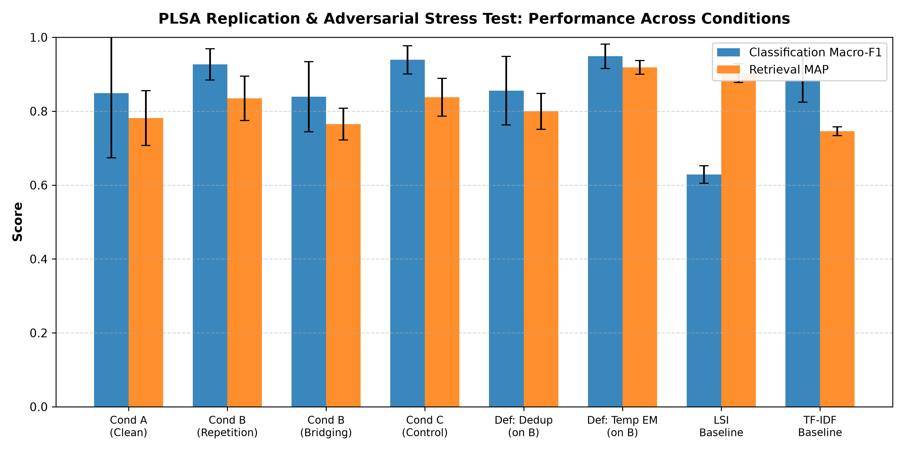

# Topic Modeling Beyond Keywords: Probabilistic Latent Semantic Analysis (Replication and Adversarial Stress Testing)

**Course:** Information Retrieval (CS F469 / Category 1: Classic Paper Replication and Stress Testing)  
**Group 1:** Soham Vinay Deshmukh, Anish Sai Nimmagadda, Romit Jain, Goutham Mahesh  
**Repository:** [https://github.com/ItsSoham23/IR-PROJECT](https://github.com/ItsSoham23/IR-PROJECT)  

---

## 1. Project Overview

This project provides a complete, from-scratch implementation of **Probabilistic Latent Semantic Analysis (PLSA)** via the Expectation-Maximization (EM) algorithm (Hofmann, 1999) using NumPy and SciPy. We evaluate PLSA under both standard retrieval/topic-modeling conditions and **adversarial poisoning stress tests** (inspired by Mei & Zhu, 2015), examining topic stability, held-out classification Macro-F1, perplexity, and IR ranking metrics (Precision@K, MAP, NDCG@K).

### Experimental Conditions
- **Condition A (Clean Baseline):** Clean training set (256 docs across 4 balanced categories: Campus, Politics, Sports, Technology).
- **Condition B (Adversarial Poisoning):** 256 clean docs + 10 injected poison documents targeting a specific category topic:
  - *B_repeat:* Keyword repetition of top target words.
  - *B_bridge:* Semantic bridging mixing target category with a confuser category.
- **Condition C (Random Control):** 256 clean docs + 10 random-word documents (drawn uniformly from training vocabulary) to control for corpus size expansion.
- **Defenses:** Cosine deduplication filtering (`sim > 0.75`), Tempered EM ($\beta = 0.85$). Likelihood trimming is an available utility, not a main experimental condition.

---

## 2. Repository Structure

```
IR-PROJECT/
├── README.md                          # Project documentation and quickstart
├── requirements.txt                   # NumPy, SciPy, scikit-learn, pytest, matplotlib, bs4, PyMuPDF
├── .gitignore                         # Data artifacts, cache, and results filtering
├── data/
│   ├── raw/                           # Ignored local outputs; ingestion is currently incomplete
│   │   ├── Campus/                    # Target: 80 official BITScan magazines; see source audit
│   │   ├── Politics/                  # Target: 80 Wikinews articles
│   │   ├── Sports/                    # Target: 80 Wikinews articles
│   │   └── Technology/                # Target: 80 Wikinews articles
│   ├── processed/                     # splits.json, vocabulary, count matrices
│   ├── metadata.csv                   # Authoritative 320-source registry
│   └── corpus.sqlite                  # Ignored local database; must be built from current metadata
├── src/
│   ├── __init__.py
│   ├── ingest_corpus.py               # Versioned ingestion of Wikinews, HTML & PDF sources
│   ├── dataset.py                     # Selection, 80/20 stratified splitting, vocabulary
│   ├── preprocess.py                  # Cleaning, tokenization, stopwords; no lemmatization
│   ├── plsa.py                        # Core EM, Tempered EM, Folding-In, Perplexity
│   ├── align.py                       # Hungarian alignment (linear_sum_assignment)
│   ├── metrics.py                     # Macro-P/R/F1, Purity, NMI, Perplexity, Potency
│   ├── attack.py                      # Keyword repetition & bridging poison generators
│   ├── defense.py                     # Deduplication and likelihood-trimming utilities
│   ├── retrieval.py                   # Query folding-in, ranking, P@K, MAP, NDCG
│   ├── evaluate.py                    # Shared PLSA/LDA evaluation
│   ├── coherence.py                   # NPMI topic coherence
│   ├── evasion.py                     # Test-time token perturbations
│   ├── fold_in.py                     # Text-level folding-in helper
│   └── baselines.py                   # LSI (TruncatedSVD), TF-IDF + KMeans
├── experiments/
│   ├── stage0_20news.py               # Mini-replication on 20 Newsgroups
│   ├── run_conditions.py              # Separate 20 Newsgroups stress-test pipeline
│   ├── run_self_collected.py          # Full 5-seed evaluation on the 320-document corpus
│   ├── lda_baseline.py                # Gensim LDA vs PLSA comparison
│   ├── poison_budget.py               # Poison-budget sensitivity sweep
│   ├── test_time_evasion.py           # Folding-in evasion experiment
│   └── visualize_*.py                 # Stretch-experiment plots
├── tests/
│   ├── test_em_monotone.py            # Verifies monotonic non-decreasing log-likelihood
│   ├── test_normalization.py          # Verifies proper probability distributions
│   └── test_synthetic_recovery.py     # Verifies topic recovery on synthetic topic mixtures
├── results/
│   ├── condition_comparison.png       # Historical comparison figure
│   ├── self_collected_summary.json    # Historical metrics and bootstrap CIs
│   └── condition_results.json         # Separate 20 Newsgroups run records
└── reports/
    └── status_update_draft.md         # 4-page intermediate status update report draft
```

---

## 3. Installation & Setup

```bash
# Clone the repository
git clone https://github.com/ItsSoham23/IR-PROJECT.git
cd IR-PROJECT

# Create and activate virtual environment (optional)
python -m venv venv
# Windows:
venv\Scripts\activate
# Linux/macOS:
source venv/bin/activate

# Install dependencies
pip install -r requirements.txt
# To reproduce the tested package versions on CPython 3.13.7 / Windows:
pip install -r requirements-lock.txt
```

`requirements.txt` remains the supported broad dependency list.
`requirements-lock.txt` captures the verification environment, including transitive
packages. [The environment record](reports/verification_environment.json) records
Python, OS and package versions. Fixed seeds support repeatability within a tested
environment; identical numerical results across platforms/library versions have
not been established.

---

## 4. Running the Verification Suite

```bash
python -m pytest -v tests/
```
The suite covers the model, ingestion, dataset, observed source-pattern, and attack-potency regression tests:
- [x] Monotonic training log-likelihood across EM iterations.
- [x] Proper normalization of $P(z|d,w)$, $P(w|z)$, $P(d|z)$, and $P(z)$.
- [x] Accurate topic recovery on synthetic topic mixture matrices ($\ge 0.85$ Macro-F1).
- [x] Stable folding-in on held-out documents.

---

## 5. Running Experiments

### Quick offline live demo

After rebuilding the corpus, use an explicit 20-document-per-category subset
(64 train / 16 test total) for a short demonstration. This runs the clean
baseline, keyword-repetition poisoning, bridging poisoning, random-control
condition, deduplication defense, and tempered-EM defense. It also evaluates
held-out documents and prints the learned top words:

```bash
# From the repository root, after activating the virtual environment:
python demo.py
```

The demo is offline after ingestion and uses a smaller subset for speed. It does not
download the 20 Newsgroups dataset or run the longer five-seed experiments.
It rebuilds its seed-42 artifacts in `data/demo_processed/`, keeping them
separate from experiment outputs.

### Ingest Corpus from Google Sheets
```bash
python -m src.ingest_corpus
python -m src.dataset
```

### Corpus rebuild and validation

The current design is 80 sources each for Sports, Technology, Politics and Campus.
Corpus preparation requires all four complete categories and produces 256 training
and 64 held-out documents. The model vocabulary still uses `min_df=2` and
`max_df_ratio=0.85`, fitted exclusively on training text.

Ingestion routes Wikinews through MediaWiki with an article HTML fallback, normal
pages through BeautifulSoup, and PDF URLs or PDF responses through PyMuPDF.
Google Drive viewers are converted to download requests; permissions/confirmation
pages fail with an actionable error instead of entering the corpus. PDF signature,
text-layer coverage and extraction quality are checked. Empty, garbled and fewer
than 50-word extractions are rejected; over 5,000 words is reported as unusually
long. `data/ingestion_report.json` records counts, warnings and failures.

Extraction version `corpus-v2.1` invalidates all earlier cleaning caches.
BITScan cleaning compares restricted page-edge layout signatures after normalizing
changing page numbers. It covers observed Pilani, Hyderabad and Goa footer forms,
including issue/semester punctuation, as well as page numbers, TOC dot leaders
and contact labels. It preserves
campus names and substantive editorial prose. PDF text blocks are extracted in a
deterministic order to reduce column interleaving. Scanned PDFs require OCR; this
pipeline does not silently run OCR or accept an empty text layer.

Wikinews cleaning removes observed leading publication dates, citation/link
sections and the opinion invitation. HTML related-story boxes are excluded by
their observed `.infobox.noprint` structure; article lists and interview prose
remain. The same text cleaner runs on API and HTML extraction. Words such as
`said`, source references within prose and meaningful mentions of Wikinews are
not blacklisted.

Real magazine samples showed that a whole-document prefix often selects the
editorial. Campus PDFs therefore use the first substantial non-front-matter page
(at least 50 words), skipping observed editorial/contents openings and a Pilani
editorial continuation. The selected page is bounded by complete sentences where
possible. Other sources retain a sentence-bounded prefix. The shared word budget
is the 90th percentile of cleaned **non-Campus training** documents, excluding the
magazines from the reference distribution. This retains the ordinary article
length range while bounding magazine mass. Override `max_document_words` or
`length_percentile` in `prepare_document_corpus(...)` when needed. The cap is
recorded per split, and the selected page is recorded per Campus document.
Full cleaned extraction, including editorial prose, stays in SQLite. The final partial
sentence is omitted when a preceding sentence fills at least half the budget;
otherwise a word-boundary prefix handles PDFs without reliable punctuation.

Cached sources must match URL, metadata hash, extraction version and text hash.
A matching raw filename alone is never trusted. Changed/removed sources are
invalidated before fetching; failed or interrupted runs cannot be modeled.
Missing/modified raw files are regenerated from verified SQLite text. Legacy
SQLite data is backed up to `corpus.sqlite.legacy.bak` on its first migration.
Use `--force` to refresh same-URL content or force a full re-extraction:

```bash
python -m src.ingest_corpus --force
# Or use the reviewed metadata snapshot without contacting the Sheet:
python -m src.ingest_corpus --metadata data/metadata.csv --audit-path reports/dataset_source_audit.csv
python -m src.dataset
```

Preparation always rebuilds matrices/vocabulary and writes a versioned split
manifest with a source fingerprint, seed, counts and normalization policy.
If validation fails, `splits.json` is marked `rebuild_required`; old generated
matrices must not be used. Existing source files are preserved, but legacy
SQLite rows and incomplete corpora are rejected. A larger future candidate pool
still supports median-length subset selection; exactly 80 valid sources uses
all 80. The 20 Newsgroups experiments retain their separate dataset configuration.

Generated raw text and SQLite databases are no longer tracked. Existing local
copies were preserved, but a fresh clone contains the metadata registry and
`.gitkeep` placeholders, not an already populated corpus. The current audit is
incomplete; full preparation and final experiments remain blocked until every
category has 80 valid sources. The text-free [per-source CSV](reports/dataset_source_audit.csv)
records acceptance, counts, failures, source types, hashes and extractor version.

Attack potency now uses each condition's own topic-to-class alignment. Target
probability drift compares the same semantic class across models. Both frozen
models fold in the identical clean-training count matrix X for likelihood:

`L(X; M) = sum_dw X_dw * log(sum_k theta_M(d,k) * phi_M(k,w)) / sum_dw X_dw`

`delta_eval_ll_per_token = L(X; condition) - L(X; baseline)` is in nats/token;
negative values mean worse fit to the shared corpus. It is an in-sample diagnostic,
not a held-out generalization score. Raw objectives from clean and augmented
training corpora are never subtracted. Corrected results are written to
`results/dataset_320/attack_potency.json` after an experiment run.

See [the dataset update audit](reports/dataset_update_audit.md) for observed
word counts, current source failures and rebuild status.

### Run Stage 0 Mini-Replication (20 Newsgroups)
```bash
python experiments/stage0_20news.py
```

### Run Full 5-Seed Experiments on Self-Collected Corpus
```bash
python experiments/run_self_collected.py
```

### Run the stretch experiments
```bash
python experiments/lda_baseline.py
python experiments/poison_budget.py
python experiments/visualize_budget.py
python experiments/test_time_evasion.py
python experiments/visualize_evasion.py
python experiments/visualize_coherence.py
```

The self-collected and stretch scripts write new JSON summaries, dataset manifests,
and PNG figures under `results/dataset_320/`. Existing files directly under
`results/` and `assets/` are historical and are never loaded as the new dataset.
They use the four existing corpus categories, so the default topic count is
four. Main parameters are exposed as Python function arguments for
reproducible reruns.

---

## 6. Historical Experimental Results Summary

These tables and figures describe the old 100-document design, including the
retired Campus sources. They are retained as historical results, not results
for the new 320-document corpus. Re-run the experiments to obtain new metrics.

### Reproducibility revision

The current protocol removes BITS navigation boilerplate before tokenization,
uses seeded five-restart PLSA with a 1000-iteration ceiling and
`tol=1e-6`, protects all real training documents during poison deduplication,
and measures every model's fit time and peak memory at runtime. The attack
comparison must be interpreted against the random-control condition and the
five-seed confidence intervals; a poisoned score is not evidence of attack
potency unless it separates from that control.

### Self-Collected Corpus (Mean ± Std & 95% Bootstrap CI over 5 Seeds)

| Method / Condition | Classification Macro-F1 [95% CI] | Purity | Retrieval MAP | Held-out Perplexity |
|---|:---:|:---:|:---:|:---:|
| **Condition A (Clean Baseline)** | **0.849** [0.681, 0.949] | 0.890 ± 0.097 | 0.782 ± 0.074 | 743.5 ± 21.5 |
| **Condition B (Poison - Repetition)** | 0.927 [0.894, 0.969] | 0.930 ± 0.040 | 0.835 ± 0.060 | 734.7 ± 38.0 |
| **Condition B (Poison - Bridging)** | 0.839 [0.746, 0.909] | 0.860 ± 0.066 | 0.765 ± 0.043 | 759.8 ± 16.0 |
| **Condition C (Random Control)** | 0.939 [0.908, 0.970] | 0.940 ± 0.037 | 0.838 ± 0.051 | 737.2 ± 32.0 |
| **Defense: Deduplication (on B)** | 0.856 [0.780, 0.931] | 0.860 ± 0.086 | 0.800 ± 0.049 | 735.9 ± 37.7 |
| **Defense: Tempered EM (on B)** | **0.949** [0.917, 0.980] | **0.950 ± 0.032** | **0.919 ± 0.019** | **714.7 ± 27.6** |
| *Baseline: LSI* | 0.644 [0.628, 0.659] | 0.720 ± 0.024 | **0.906 ± 0.024** | N/A |
| *Baseline: TF-IDF + KMeans* | 0.816 [0.674, 0.950] | 0.830 ± 0.144 | 0.782 ± 0.015 | N/A |



---

## 7. Key References

1. **Hofmann, T. (1999).** *Probabilistic Latent Semantic Analysis.* UAI 1999. [arXiv:1301.6705](https://arxiv.org/abs/1301.6705).
2. **Hofmann, T. (1999).** *Probabilistic Latent Semantic Indexing.* SIGIR 1999.
3. **Hofmann, T. (2001).** *Unsupervised Learning by Probabilistic Latent Semantic Analysis.* Machine Learning 42, 177–196.
4. **Mei, S., & Zhu, X. (2015).** *The Security of Latent Dirichlet Allocation.* AISTATS 2015.
5. **Zhou, Y., et al. (2021).** *EvaLDA: Efficient Evasion Attacks Towards Latent Dirichlet Allocation.* AAAI 2021.
